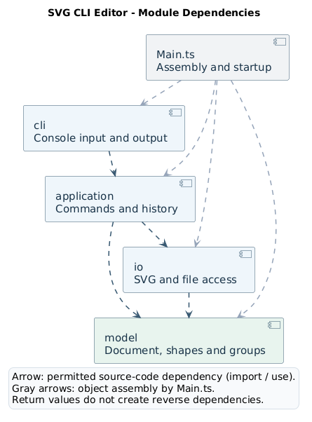
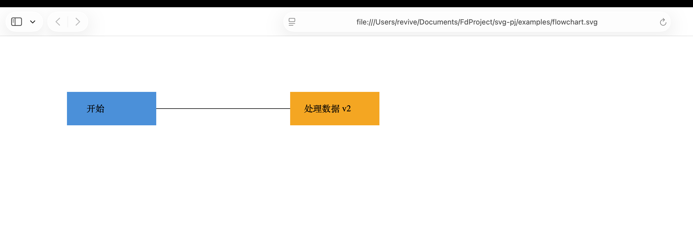

# Lab1 Phase 1：SVG 编辑器（CLI）

本报告依据[原始作业说明](phase_cli_1.md)、四轮开发记录、当前实现和提交前只读审计整理。当前已实现六种内置图形及本阶段必需的 CLI 命令；SVG 读写支持明确限定的子集。四轮执行记录、提交前审计和流程图样例的截图视觉核对分别列出；远程干净副本复现和最终 Git 交付状态见第四章。

## 架构方案

### 1. 模块划分及职责

程序按职责划分为 `cli`、`application`、`model`、`io` 四个业务模块，由 `Main` 创建对象并连接各模块。

| 模块或入口 | 代表文件 | 实际职责 |
|---|---|---|
| 命令行交互 `cli` | [CommandLine.ts](../src/cli/CommandLine.ts)、[InputParser.ts](../src/cli/InputParser.ts) | 逐行读取输入，处理双引号、转义、空行和整行注释；将参数交给应用层，打印返回文本；错误统一以单行 `error:` 输出，之后继续接收命令。交互模式显示 `svg>`，脚本模式读至 EOF 正常退出。 |
| 编辑协调 `application` | [CommandDispatcher.ts](../src/application/CommandDispatcher.ts)、[Editor.ts](../src/application/Editor.ts)、[HistoryManager.ts](../src/application/HistoryManager.ts)、[ShapeFormatter.ts](../src/application/ShapeFormatter.ts) | 分发命令，协调当前文档、读入路径和历史；组织编辑及 IO 操作；将 `tree/show` 的结果整理成显示文本。 |
| 文档与图形 `model` | [Document.ts](../src/model/Document.ts)、[Shape.ts](../src/model/Shape.ts)、[Group.ts](../src/model/Group.ts)、[ShapeFactory.ts](../src/model/ShapeFactory.ts) | 封装图形属性和几何行为，维护文档树、活动 ID、父级和节点顺序，通过唯一工厂构造图形。 |
| SVG 与文件访问 `io` | [SvgReader.ts](../src/io/SvgReader.ts)、[SvgWriter.ts](../src/io/SvgWriter.ts)、[FileAccess.ts](../src/io/FileAccess.ts) | 读取文件、解析 XML、验证导入范围、构建候选文档；序列化模型并写入文件；返回结果或抛出错误，不直接打印。 |
| 装配入口 | [Main.ts](../src/Main.ts) | `Main.run()` 创建 Editor、历史管理器、工厂、Reader、Writer、分发器和 CLI，再启动输入循环。CLI 创建和 Reader 使用同一个工厂实例。 |

以 `move r1 10 20` 为例，`InputParser.parse()` 先完成通用分词；`CommandDispatcher.dispatch()` 创建移动命令并交给历史管理器；命令调用目标 `Shape.move()`；执行成功后历史管理器入栈，CLI 打印返回文本。图形具体怎样移动，由模型的多态实现决定。

读写采用另一条协作路径：应用层调用 `SvgReader.read()` 或 `SvgWriter.write()`；模型负责图形和结构约束，IO 负责文件与 XML；应用层在成功后替换文档或建立历史边界，并返回警告、元素计数和成功信息。

现有模块依赖图如下，保留[PlantUML 源文件](architecture.puml)及 [SVG 版本](architecture.svg)：



箭头表示允许的源代码依赖，包括类型引用；深色箭头表示业务模块依赖，灰色箭头表示 Main 的装配依赖。函数返回值或警告向上返回，不表示增加了反向源码依赖。

### 2. 设计模式选择与实际落点

#### Command：编辑操作及撤销重做

[Command](../src/application/Command.ts) 定义 `execute()`；[EditingCommand](../src/application/EditingCommand.ts) 继承它并增加 `undo()`、`redo()`。各编辑命令保存自身恢复所需的信息，`HistoryManager` 统一管理两条历史栈。

`HistoryManager.execute()` 先执行命令，成功后才加入 undo 栈、清空 redo 栈并解除历史禁用。`undo()`、`redo()` 也在命令成功返回后才调整栈。查询命令不进入编辑历史；失败操作不能借由历史管理器改变栈或解除禁用。

恢复信息根据操作性质保存：

| 操作 | 保存和恢复方式 |
|---|---|
| [MoveCommand](../src/application/MoveCommand.ts)、[ScaleCommand](../src/application/ScaleCommand.ts) | 保存目标对象及执行前后的 `GeometryState`。撤销和重做调用 `restoreGeometry()`，避免用反向加减或乘除近似恢复浮点数。 |
| [SetCommand](../src/application/SetCommand.ts) | 保存对象、属性名和前后值；原值为 `undefined` 时，撤销恢复属性未设置状态，不补写默认颜色。 |
| [CreateCommand](../src/application/CreateCommand.ts)、[DeleteCommand](../src/application/DeleteCommand.ts) | 保存原图形对象及 `ShapePosition` 中的父级、索引；恢复时插回原位置，保留子树和对象身份，使较早的命令引用仍有效。 |
| [OrderCommand](../src/application/OrderCommand.ts) | 记录同级位置；撤销恢复原索引，不用反方向的 front/back 代替。 |
| [GroupCommand](../src/application/GroupCommand.ts)、[AddToCommand](../src/application/AddToCommand.ts)、[UngroupCommand](../src/application/UngroupCommand.ts) | 保存 `StructureChange`，恢复受影响子节点列表的前后状态；列表中的节点仍是原对象。 |

成功执行 `init/read/save` 或带尺寸的 `canvas` 后禁止 undo/redo，直到下一条成功编辑，这是原文规定。项目进一步选择在这些操作成功后清空两个历史栈，防止撤销越过文档边界；这是实现约定，不是将“禁用”与“清空”混为同一条原文要求。

#### Composite：统一叶子与嵌套容器

`Shape` 定义移动、缩放、属性设置、几何快照及子节点查询接口。[Rect](../src/model/Rect.ts)、[Circle](../src/model/Circle.ts)、[Ellipse](../src/model/Ellipse.ts)、[Line](../src/model/Line.ts)、[Text](../src/model/Text.ts) 实现各自几何行为，`Group extends Shape` 通过 `ChildList` 持有孩子。

`Group.move()/scale()` 对孩子调用相同接口，嵌套时递归至叶子，每个叶子变换一次。当前采用共同坐标系中的叶子几何，不保存累计 SVG transform；先移动组、后加入新孩子，不会把旧移动重新施加给新孩子。

叶子先计算并验证全部候选几何值，再提交修改。Group 的 `changeChildrenAtomically()` 保存孩子的几何快照；若后面的孩子溢出或失败，则恢复全部孩子，包括已成功修改的前面节点及嵌套组。该恢复保留对象身份，避免整组操作只完成一部分。

Group 的 `set` 只接受自身的 `fill/stroke/stroke-width`，不递归覆盖孩子显式样式。结构编辑保留节点显式属性，但不计算或冻结继承样式，因此不能承诺重新归属或解组后最终渲染外观始终不变。

#### 简单工厂：CLI 与导入共用图形创建入口

`ShapeFactory.create()` 接收 CLI 参数，`fromAttributes()` 接收 XML 标签对应的结构化属性和文本；二者调用同一个 `definition()`，共用几何字段、缺省值和构造函数。`create g` 与 `GroupCommand` 新建组也复用该入口。Reader 不另建六种图形的构造分支，也不将 XML 拼成 CLI 命令字符串。

Writer 调用 `Shape.describe()` 获得标签、ID、显式属性、可选文本及有序孩子。`Text.describe()` 将文字内容表示为子文本，`SvgWriter.element()` 统一序列化描述，不按具体图形类重复分派。

这里实现的是简单工厂，尚未实现 GoF Factory Method 或动态插件注册。按作业要求保留的两个**待重构点**为：

| 位置 | 当前职责 | 后续重构方向 |
|---|---|---|
| `CommandDispatcher.createCommand()` | 唯一的命令名称到命令对象分派 | 命令注册机制 |
| `ShapeFactory.definition()` | 唯一的图形类型名称到类型定义及构造函数分派 | 图形提供者注册机制 |

它们是本阶段允许保留的集中分派。模型内部的属性白名单负责验证本类型可编辑的字段，工厂中的类型分派负责选择具体类，两者职责不同。

### 3. 依赖方向规则及理由

| 模块或入口 | 允许依赖 | 理由 |
|---|---|---|
| `cli` | `application` | 输入交给应用层，显示应用层返回的结果；不操作图形对象或文件 IO。 |
| `application` | `model`、`io` | 协调编辑、读写、当前文档和历史边界。 |
| `io` | `model` | 导入构建模型，导出读取模型描述；不依赖应用层或 CLI。 |
| `model` | 不依赖其他三个业务模块 | 保持图形行为、状态和结构独立于交互入口、历史管理及文件访问。 |
| `Main.ts` | 四个业务模块 | 创建对象并装配依赖。 |

表格约束业务模块间的引用，模块内部协作及 Node/XML 库引用按职责使用。`tree/show` 已由 `ShapeFormatter` 组织显示文本，CLI 不遍历模型；IO 不直接输出终端信息；模型不知道撤销栈；Main 不承担编辑算法。

提交前审计通过各源码文件的导入与类声明检查对照这些规则。审计结果及代表性依据见“一致性自查”。

### 4. 变化点假设与准备程度

| 可能的变化 | 当前可复用部分 | 仍需修改或新增的部分 |
|---|---|---|
| 新图形、复合图形 | Shape 多态接口、Group 组合结构、唯一工厂、描述式写出 | 新模型类、工厂定义、属性语义及测试；box 还需要内部部件规则、类型标记和读回机制，当前没有插件加载能力。 |
| 新命令或语法 | Command、EditingCommand、HistoryManager、CLI 通用分词 | 命令实现、分发、参数检查、help 和测试；动态注册尚未实现。 |
| GUI/Web 入口 | 模型和部分应用层命令 | 当前查询返回显示文本，图形界面可能需要结构化查询、事件和交互接口；文件 IO、Node 环境相关部分也需适配。 |
| 扩大 SVG 支持范围 | 独立 Reader/Writer、模型校验及往返测试 | transform、CSS、文字排版、更多标签和坐标映射需要真实语义及测试，不能仅放宽解析白名单。 |
| 改变存储方式 | 文件访问集中在 FileAccess，应用层通过 IO 协调 | 当前是同步本地文件访问；远程存储需要新的接口或实现，异步后还需保证命令顺序。依赖方向若改变，应同步修订方案。 |

本阶段面向固定的六种图形、命令行入口和本地文件读写，因此保留 Shape/Command 多态及独立 IO 边界，暂不引入动态插件注册、GUI 事件体系和远程存储接口，以控制实现与验证成本。出现相应需求后，再扩展接口并同步修订依赖方案。

## 过程记录

### 1. 需求与初始方案

实现前先整理 CLI、六种图形、结构树、撤销重做和 SVG 读写要求，确定四模块及 Main 装配的方案，并形成现有 PlantUML 图。初期选择 Command、Composite 和简单工厂，集中保留两个名称分派点，不提前建立插件或 GUI 框架。

开发按最小流程、普通图形、层级、IO 四轮推进。下面的数量是各轮已有执行记录，不是本次报告整理重新运行的结果，也不是测试覆盖率。

| 轮次 | 主要实现范围 | 当时的阶段边界 | 当轮测试结果 |
|---|---|---|---:|
| 第一轮 | CLI、rect、init/create/move/tree/show/undo/redo/help，Command 与历史管理 | 当时仅有 Shape 抽象和 Rect，Group 尚未实现；io 尚未创建 | 26 项通过 |
| 第二轮 | circle/ellipse/line/text，scale/set/delete/front/back，扩展已有编辑与显示 | 五种叶子仍位于根下；Group 和层级操作属于下一轮，IO 尚未实现 | 47 项通过 |
| 第三轮 | Group、六种图形的 in、group/ungroup/addto、子树操作和递归变换 | 层级模型完成；read/save/canvas 留待第四轮 | 68 项通过 |
| 第四轮 | SVG 读写、canvas、默认读入路径、文档历史边界及往返验证 | 必需命令已有实现；完整 SVG/CSS 支持仍有限制，box/插件不在本阶段范围 | 91 项通过 |

### 2. 有代表性的设计决定

第一轮先完成 `init → create rect → move → undo/redo → tree/show` 的最小流程，将输入、命令、模型和历史连接起来。为避免通过逆运算恢复时引入数值偏差，移动命令保存前后几何快照，撤销和重做直接恢复相应状态。

第二轮把图形差异放入各模型类，移动和缩放命令继续面向 Shape 工作。SetCommand 同时保留值和未设置状态；删除保留原对象及位置，使 `create → move → delete → undo delete → undo move` 仍作用于当前文档里的同一图形。OrderCommand 同时服务 front/back，并恢复精确索引。

第三轮引入 ChildList、StructureChange 和全文档结构校验。为避免多个节点连续移除造成位置偏移，分组在操作前确定成员顺序和受影响列表，恢复时使用原对象列表。根级 g 禁止用户执行 ungroup，但撤销根级 group 必须成功，因此 `GroupCommand.undo()` 调用 `StructureChange.restoreBefore()`，不调用受根级限制的 UngroupCommand。整组变换则以快照回滚保证晚发生的溢出不会留下半修改状态。

第四轮开始实现 IO。`read` 先完整构造并验证候选 Document，成功后 `Editor.acceptRead()` 才替换当前文档、记录路径并重设历史。先收集并预留文件中全部显式 ID，再按深度优先顺序为匿名图形编号，避免前面的匿名 rect 占用后面显式使用的 rect1。警告暂存在读取结果中，失败读取不输出看似成功的补 ID 警告。

CLI 和 SVG 导入共用工厂定义，写出统一读取模型描述；这样避免产生两套类型构造规则。保存先完成内存序列化，再写同目录独有临时文件，关闭后 rename 替换目标。默认路径单独记录为“成功读入的路径”，显式 save 不覆盖它。文件外部写入成功后，应用层才建立保存后的历史边界。

### 3. 协作与证据边界

Codex 按用户确认的分轮范围承担代码、配置、测试及命令验证，并在提交前完成只读审计。用户负责需求和设计确认、提供浏览器预览及最终交付决定。报告引用既有执行记录，并结合提交的文档和截图进行复核。

用户已提供 Safari 打开 `examples/flowchart.svg` 的截图。根据该截图，蓝色“开始”节点、橙色“处理数据 v2”节点、中文文字、水平黑色连线及相对布局显示正常，未见 XML 解析错误页面，已完成该保存样例的静态视觉核对。远程干净副本复现和最终交付仍待确认。

## 一致性自查

模块目录与方案一致：当前已有 cli、application、model、io 及 Main。此前只读审计检查了 43 个源码文件，未发现违反依赖方向的引用；这些文件均符合一类一文件和类名对应文件名的要求。以下列出该审计可定位的代表性依据。

| 检查项 | 方案要求 | 实现依据 | 结论或偏差 |
|---|---|---|---|
| 模块职责 | 四个业务模块各司其职 | CommandLine/InputParser；Editor/CommandDispatcher；Document/Shape；SvgReader/SvgWriter/FileAccess | 实际目录和职责与方案一致，IO 已实现。 |
| 一类一文件 | 类名与文件名一致 | [Main.ts](../src/Main.ts)、[Rect.ts](../src/model/Rect.ts)、[ReadCommand.ts](../src/application/ReadCommand.ts) 等 | 审计检查 43 个源码文件，未发现命名或类文件拆分偏差。 |
| 字段封装与多态 | 通过方法维护状态，不重复按图形类型实现行为 | Shape 抽象方法、Rect 等叶子的实现、Group 的递归实现；各类使用私有或受保护字段 | 命令调用图形方法；模型内部属性白名单属于本类型属性处理。 |
| Command 与历史 | 命令对象封装操作，成功后才调整历史 | [EditingCommand.ts](../src/application/EditingCommand.ts)、[HistoryManager.ts](../src/application/HistoryManager.ts) | 编辑执行、撤销、重做遵循统一历史入口。 |
| Composite | 叶子与容器统一操作 | [Shape.ts](../src/model/Shape.ts)、[Group.ts](../src/model/Group.ts) | Group 继承 Shape，递归几何操作及自身样式行为已落地。 |
| 两处名称分派 | 仅保留命令分派和工厂分派 | `CommandDispatcher.createCommand()`、`ShapeFactory.definition()` | 已集中；两处明确标为待重构点，不是未完成功能。 |
| CLI 依赖 | cli → application | [CommandLine.ts](../src/cli/CommandLine.ts) 依赖 CommandDispatcher；[ShapeFormatter.ts](../src/application/ShapeFormatter.ts) 负责模型显示 | CLI 不直接导入 model/io，也不遍历图形树。 |
| 应用层协调 | application → model、io | [ReadCommand.ts](../src/application/ReadCommand.ts)、[SaveCommand.ts](../src/application/SaveCommand.ts)、[Editor.ts](../src/application/Editor.ts) | 应用层在成功后更新当前文档、路径及历史。 |
| IO 边界 | io 只依赖 model，不反向依赖其他业务模块 | [SvgReader.ts](../src/io/SvgReader.ts)、[SvgWriter.ts](../src/io/SvgWriter.ts) | 审计未见依赖违规；IO 不直接输出终端信息。 |
| 唯一图形工厂 | CLI 与导入共用类型选择 | [CreateCommand.ts](../src/application/CreateCommand.ts) 调用 `create()`；Reader 调用 `fromAttributes()`；二者调用 `definition()` | 无第二套 Reader 图形构造分派，无 XML 转 CLI 字符串流程。 |
| 统一序列化描述 | model 不依赖 XML 库或 IO 类型 | `Shape.describe()`、[Text.describe()](../src/model/Text.ts)、`SvgWriter.element()` | Writer 通用处理描述，文字作为子文本输出。 |
| 装配入口 | Main 可以依赖四模块 | [Main.run()](../src/Main.ts) | 创建并连接对象，业务逻辑留在对应模块。 |

结构管理的职责进一步划分为：

- [ChildList](../src/model/ChildList.ts) 封装有序子节点集合，`getChildren()` 返回副本；`replaceValidated()` 是供 Document 完成校验后使用的内部约定接口，命令不直接修改孩子数组。
- [StructureChange](../src/model/StructureChange.ts) 保存受影响列表的操作前后状态及应用回调，`restoreBefore()/restoreAfter()` 保留节点对象引用。
- [Document](../src/model/Document.ts) 维护根列表、活动 ID 和直接父级映射；`applyStructure()` 先验证整棵候选树的循环及重复 ID，再提交列表和索引。删除对象即使仍被历史引用，也不出现在活动 ID 查询中。SVG 根不占用普通图形 ID。

对照原作业，审计未发现本阶段必需命令的明确遗漏；这不表示完整 SVG 标准或所有背景示例均已支持。具体格式限制、项目约定及后续功能在第四章分别列出。

## 质量保证手段

### 1. 功能要求与测试、验收资料对应

测试使用 Node 内置 `node:test` 和断言库，关注用户可观察结果及失败后状态。下表引用现有测试和脚本；测试数量不能当作覆盖率。

| 要求或风险 | 现有测试证据 | 验收资料与关键结果 |
|---|---|---|
| 输入、错误恢复、提示符和 EOF | [parser.test.ts](../test/parser.test.ts)、[cli.test.ts](../test/cli.test.ts) | 空行和整行注释忽略；颜色保留；支持引号、中文及空字符串；错误后继续执行，交互显示 `svg>`。 |
| init、创建与基础历史 | [editor.test.ts](../test/editor.test.ts) | [core.svgcmd](../test/fixtures/core.svgcmd)：矩形 `(10,20)` 移动至 `(40,15)`，undo/redo 恢复对应坐标。 |
| 成功与失败对 redo 的影响 | editor.test.ts、[edits.test.ts](../test/edits.test.ts) | [history.svgcmd](../test/fixtures/history.svgcmd)：失败编辑保留 redo，成功新编辑清空 redo。 |
| 五种叶子的 move/scale/set/delete/front/back | [shapes.test.ts](../test/shapes.test.ts)、edits.test.ts | [shapes-and-edits.svgcmd](../test/fixtures/shapes-and-edits.svgcmd)：line 两端同时移动；circle 等比缩放；文本、未设置样式及原顺序可撤销恢复。 |
| 全局 ID、in、分组、解组、归属和同级顺序 | [hierarchy.test.ts](../test/hierarchy.test.ts) | [hierarchy.svgcmd](../test/fixtures/hierarchy.svgcmd)：真实直接父级、跨父分组恢复、根级 ungroup 拒绝、嵌套 ungroup 可撤销。 |
| 整组原子性及旧历史对象引用 | [group.test.ts](../test/group.test.ts) | 包含晚发生的后代溢出回滚，以及叶子编辑、组移动、子树删除逐次撤销仍作用于同一活动对象的断言。 |
| other.svg、补 ID 与导入失败 | [svg.test.ts](../test/svg.test.ts)、[io.test.ts](../test/io.test.ts) | [other.svg](../test/fixtures/other.svg) 断言 7 个图形和 `warning: assigned id rect1 to unnamed <rect>`；预留后出现的显式 ID；晚失败不输出补 ID 成功警告。 |
| SVG 往返及明确拒绝不支持内容 | svg.test.ts | 六种类型、嵌套、混合兄弟顺序、显式样式、空文本、中文、首尾空格、`001`、`false`、XML 特殊字符及字面量 `&amp;`；坏 XML、transform、style 和不匹配 viewBox 的拒绝断言。 |
| 默认路径、canvas、文档历史边界、写入保护 | io.test.ts、cli.test.ts | [io.svgcmd](../test/fixtures/io.svgcmd) 由 [run-io.sh](../test/run-io.sh) 准备输入副本后回放；测试覆盖部分写入、关闭及替换失败，检查旧字节、redo 和本次临时文件清理。 |
| help 及原文错误 | editor.test.ts、edits.test.ts、hierarchy.test.ts、io.test.ts | 检查未知类型/属性、目标不存在、非法容器、非正缩放、根级解组及文档历史禁用等错误；help 与当前范围一致。 |

文件测试使用专用临时目录，无参 save 的输入先复制，避免改写原始 fixture。失败场景使用可重复的文件条件或注入失败，不仅依赖 chmod。SVG 往返比较模型语义，不要求 XML 属性顺序、缩进或字节完全相同。

### 2. 已执行验证与本次整理的范围

测试结果来自对应开发轮次；提交前审计重新执行了类型检查并检查结构与声明问题，未重跑测试套件。报告整理与复核依据上述记录及用户提供的浏览器截图，不新增测试运行结果。

| 证据来源 | 结果 | 能够说明的范围 |
|---|---|---|
| 四轮开发执行记录 | 第一轮 26、第二轮 47、第三轮 68、第四轮 91 项测试通过 | 各轮当时的测试结果。第一至第三轮分别有两份、三份、四份脚本通过的既有记录。 |
| 提交前只读审计 | `npm run typecheck` 通过；确认 43/43 个 src 文件纳入检查，加上测试共 55 个工程 TypeScript 文件 | 标准严格配置下的检查结果；不是最低 Node 版本或跨平台验证。 |
| 提交前只读审计 | 全部 43 个源码文件的导入及类文件检查未发现规则偏差 | 对应当时源码的结构检查；代表性代码依据见第三章。 |
| 提交前只读审计 | 确认现有 91 个测试定义及断言；没有重跑测试套件 | 为要求与已有测试建立对应。 |
| 提交前只读审计 | 临时关闭 skipLibCheck 后退出码 2，五条错误均来自 saxes 声明文件 | 具体原因见本章类型检查说明。 |
| 报告整理与复核 | 整理四大章节、核对必要引用、检查文档差异，并根据新增截图更新验收状态 | 文档与截图核对；未重新运行程序或测试。 |
| Safari 流程图截图 | 蓝色“开始”、橙色“处理数据 v2”、中文文字和水平黑色连线均正常显示，未见 XML 解析错误页面 | 已完成该保存样例的静态视觉核对；不扩展为其他 SVG 文件或其他浏览器的验证结果。 |

第四轮的 91 项执行记录包含实际 CLI 子进程测试，覆盖四份既有命令脚本及 IO fixture。流程图截图提供了模型及 XML 验证之外的显示效果证据。

### 3. 可复现运行说明

在仓库根目录执行下列命令即可安装依赖、检查类型、运行测试和启动交互界面。

审计环境为 Node.js **26.13.0**、npm **11.20.0**、TypeScript **5.9.3**。项目声明 Node `>=22`，但最低版本未验证；这里记录的是提交前审计环境，各轮开发使用的环境以当轮记录为准。依赖和锁定版本见 [package.json](../package.json) 与 [package-lock.json](../package-lock.json)；XML 解析使用 `saxes@6.0.0`，其传递依赖 `xmlchars` 锁定为 2.2.0。

```sh
npm ci
npm run typecheck
npm test
npm run cli
```

`typecheck` 执行 `tsc --noEmit`；`test` 先构建，再运行 `node --test dist/test/*.test.js`；`cli` 先构建，再运行 `node dist/src/Main.js`。无需将本机绝对路径或临时工具目录写入脚本，依赖和生成的 dist 不纳入源码交付。

回放验收资料：

```sh
npm run cli < test/fixtures/core.svgcmd
npm run cli < test/fixtures/history.svgcmd
npm run cli < test/fixtures/shapes-and-edits.svgcmd
npm run cli < test/fixtures/hierarchy.svgcmd
sh test/run-io.sh
```

`run-io.sh` 自动建立专用临时目录，将 other.svg 复制为带空格的输入文件名，再从该目录执行 IO fixture，结束时清理；无需直接对仓库原样例执行无参 save。脚本内含预期错误场景，不能把出现任何 `error:` 都判为回放失败，应对照测试断言和以下结果检查。

- line 从 `(0,0) → (100,50)` 移动 `(5,-10)` 后为 `(5,-10) → (105,40)`；circle 的 `(cx,cy,r)=(100,100,20)` 缩放 2 后为 `(200,200,40)`。
- 流程图中 `move node2 0 100` 使 process 的 y 从 100 到 200，process-label 的 y 从 135 到 235，node1 和 arrow1 不变；一次 undo 恢复 node2 全部后代。
- 根级 `ungroup flowchart` 输出规定错误，嵌套 `ungroup node1` 成功并可撤销；show 的 parent 随结构及恢复正确变化。
- other.svg 读入为 7 个图形；读写失败不破坏原 redo；canvas 查询不改变历史，成功修改尺寸后进入文档历史边界。

流程图保存样例为 [examples/flowchart.svg](../examples/flowchart.svg)，对应生成脚本为 [flowchart.svgcmd](../examples/flowchart.svgcmd)。第四轮记录中该样例由 CLI 的 save 生成；以下命令可重新生成并覆盖该样例文件：

```sh
npm run cli < examples/flowchart.svgcmd
```

脚本采用原作业第 6.1 节普通 g 版本，最终有 8 个图形（包含三个 g，不计 svg 根），process-label 内容为“处理数据 v2”。已根据用户提供的 Safari 预览截图完成该保存样例的静态视觉核对，结果见本章第 6 节；本次报告修订未重新生成 SVG。

### 4. 类型检查配置与第三方声明问题

[tsconfig.json](../tsconfig.json) 启用 `strict: true`、`exactOptionalPropertyTypes: true`、`noUncheckedIndexedAccess` 等检查。`include` 为 `src/**/*.ts` 和 `test/**/*.ts`，没有手写 `exclude`；有效配置排除输出目录 dist。审计已确认所有 43 个 src 文件都在检查范围，加上测试共 55 个工程 TypeScript 文件。

标准检查使用 `skipLibCheck: true` 并通过。此前审计用 TypeScript 5.9.3 临时执行以下命令，没有改写配置：

```sh
npm run typecheck -- --skipLibCheck false
```

实际退出码为 2，错误均在 `node_modules/saxes/saxes.d.ts`：

| 错误及位置 | 已确认原因 |
|---|---|
| TS2344，46:71、55:80、62:61、69:62 | 四个事件处理器的泛型 `O` 未声明约束，却传入要求 `O extends SaxesOptions` 的类型。 |
| TS2430，265:18 | `NSOptionsWithoutNamespaces` 将 `additionalNamespaces` 声明为可选 `undefined`，与父接口的可选 `Record<string, string>` 在 `exactOptionalPropertyTypes: true` 下不兼容。 |

问题定位于 saxes 6.0.0 声明与当前 TypeScript 配置的兼容性。`skipLibCheck` 跳过声明文件的检查，影响范围不只 saxes；本项目 `.ts` 源码仍纳入严格检查。当前保留已验证的依赖和配置，后续可在单独变更中解决声明兼容问题，再验证是否能关闭该选项。

### 5. SVG 导入范围、项目约定与限制

#### 实际支持的导入子集

| 内容 | 支持范围与缺省规则 |
|---|---|
| XML 格式 | 真正的 XML 解析器；UTF-8、XML 1.0；处理 XML 声明、注释、结构间空白和 CDATA，拒绝坏 XML；不将文本或 ID 自动转换成数值或布尔值。 |
| 根及命名空间 | 单个 svg 根；SVG 命名空间（允许前缀）或一致的无命名空间文档。命名空间声明正常处理，其他命名空间属性和不同命名空间元素拒绝。 |
| 根属性 | width/height 必须明确提供且为正有限数；可无 viewBox，或为数值上对应画布的 `0 0 width height`；其他根属性（包括继承样式）不支持。 |
| 图形与结构 | rect、circle、ellipse、line、text、g；任意合法嵌套的 g；保持混合标签的同级顺序；所有活动 ID 全文档唯一。 |
| 图形属性 | id、已有几何属性，以及显式 fill、stroke、stroke-width；Group 只接受这三种公共样式，不增加几何属性。 |
| 长度与尺寸 | 完整无单位数值或小写 px，可有负坐标、小数和指数；不转换百分比或其他单位。width/height/r/rx/ry/stroke-width 非负有限。 |
| 几何缺省 | rect 的 x/y、circle/ellipse 的 cx/cy、line 未给出的端点坐标、text 的 x/y 默认 0；矩形宽高、圆半径、椭圆 rx/ry 必须提供。 |
| 文本与样式 | text 仅纯文本，没有内容时为空字符串；保留首尾空白、中文、空串和数字样式字符串；实体只解码一次。未设置的样式保持缺失，不补默认值；fill/stroke 保存输入字符串，不额外验证 CSS 颜色语法。 |
| 自动补 ID | 仅缺失 id 时补齐；先预留所有显式 ID，再按深度优先顺序，按标签从 1 寻找未占用编号，跨类型避开同名 ID。显式空 ID、含空白 ID 或重复 ID 报错；警告只在完整读取成功后输出。 |

明确拒绝尚未建模的 transform、style/CSS/class、font-size、text-anchor、tspan/use/path 等内容，以及不匹配的 viewBox、DTD、XML 处理指令和不支持的编码。没有配置外部实体解析或资源加载。这些是本项目选择的导入限制，并非 SVG 标准要求所有文件都遵守这些限制。

导出包含 UTF-8 XML 声明、SVG 命名空间、尺寸、对应 viewBox、全部 ID、显式属性及正确嵌套顺序。文字写为子文本，文本与属性分别转义；不额外 trim 文字、不向文字内容插入缩进、不重复应用组变换。往返保持支持范围内的模型语义，不保留原 XML 字节、属性顺序、命名空间前缀、注释或排版。

原文示例的边界必须分别说明：

| [作业说明](phase_cli_1.md)中的示例 | 当前结论 |
|---|---|
| 背景最小 SVG 代码块 | 属于支持子集；审计按源码核对，未在该轮单独回放。 |
| 背景 transform 代码块 | 不能导入：外层和嵌套 g 的 transform 被拒绝；即使移除 transform，其中 text-anchor、font-size 仍不支持。 |
| 两个背景内联渲染预览 | 根 svg 带 style，当前同样拒绝，不能与不带 style 的最小代码块混为一谈。 |
| 第 6 节 other.svg | 有专门 fixture 和测试，断言 7 个图形及精确补 ID 警告。 |
| 第 6.1 节普通 g 流程图 | 属于支持范围，有层级验收脚本、生成脚本和保存样例。它通过不代表 transform 背景示例也通过。 |
| 第 6.1 节 box 版本 | 原文明确属于后续插件阶段，本阶段不要求实现。 |

#### 项目约定与原文规则的区分

| 项目 | 实际处理及依据 |
|---|---|
| 历史边界 | 原文要求成功 init/read/save/canvas 尺寸修改后禁用 undo/redo，下一次成功编辑解禁。项目选择同时清空两栈。canvas 查询、其他查询和失败操作保持历史及禁用状态。 |
| 默认保存路径 | 按读入路径作为默认目标：`read A → save B → save` 最后保存到 A。项目明确显式 save 不建立或覆盖读入路径；成功 init 清除路径；失败 init/read/save 保留原路径及相应文档状态。 |
| 无路径及空历史错误 | 无默认路径输出 `error: no save path. use 'save <file.svg>' or read a file first`；正常编辑阶段空栈分别为 `error: nothing to undo`、`error: nothing to redo`。与无文档及文档边界禁用错误区分。这些补充文案是项目约定。 |
| 参数与数值 | init 要么不提供尺寸、使用原文默认 800×600，要么同时提供两个；canvas 只接受 0 或 2 个参数。画布为正有限数；图形尺寸等采用非负有限数约定；数值完整解析，拒绝 10abc、NaN、Infinity，并检查运算结果溢出。 |
| ID 与输入 | ID 区分大小写，项目约定非空且不含空白。注释限整行，颜色中的 # 保留；双引号支持空格、空串及转义。只识别 create 参数最后独立的 `in <containerId>` 对。 |
| 分组顺序与位置 | 项目约定至少两个不同目标；按操作前全文档深度优先顺序排列。相同父级的新组置于最早选中成员的位置；跨父级追加到 SVG 根末尾；不删除被搬空的原容器。祖先和子孙同时选中按原文错误拒绝。 |
| addto 与 ungroup | addto 拒绝自身或向自己的后代移动，允许向祖先提升；移入当前父容器会排到末尾。嵌套 ungroup 在原槽位展开直接孩子，空组可移除；根级 g（包括空组）按原文禁止解组。 |
| front/back | 项目统一以列表顺序作为 SVG 输出顺序；front 移到当前同级末尾（视觉最上层），back 移到开头，不改变其他父容器。 |
| 合法无变化操作 | scale 1、设置相同值、已在末尾的 front 等仍作为一次成功编辑入历史并清空 redo。相同尺寸的 canvas 修改也作为成功文档操作建立历史边界。 |
| 缩放和样式 | 原文要求位置及尺寸同乘正 factor。项目不新增文字字号模型，text 只缩放 x/y；stroke-width、其他样式和文本内容保持不变。Group 的 set 改自身显式样式，结构编辑不冻结继承样式。 |
| 元素计数 | 读写摘要统计六种图形，包括 g，不计 svg 根、文本节点和注释；other.svg 为 7，普通流程图为 8。 |

保存流程先由 `SvgWriter` 在内存完成序列化，再交给 `FileAccess.write()` 以独有文件名在目标同目录排他创建临时文件，完整写入并关闭后 rename；失败时尽力清理本次临时文件，清理次要错误不覆盖原错误。应用层只在外部写入成功后清空并禁用历史。已有测试覆盖可重复的写入、关闭及替换失败，检查旧目标字节和历史；该设计不承诺任意系统故障或断电下的持久性，不包含文件锁、备份或断电恢复机制。

### 6. 人工验收、交付与后续范围

下图为用户提供的 Safari 预览截图，对应本地 `examples/flowchart.svg`：



根据该截图，左侧蓝色“开始”节点、右侧橙色“处理数据 v2”节点、中文文字、水平黑色连线及相对布局显示正常，未见 XML 解析错误页面。该保存样例的静态视觉核对已通过；结论限于截图中呈现的显示效果。

| 事项 | 当前证据或待确认内容 |
|---|---|
| 流程图浏览器显示检查 | 已完成：根据提供的 Safari 截图核对两节点、文字、颜色、连线及布局，显示正常。 |
| 远程干净副本复现（补充验证） | 尚未执行：用于确认远程交付完整性；在待交付提交的干净克隆中安装锁定依赖并执行类型检查、测试及验收流程，再记录环境与真实结果。 |
| 最终报告及资料提交 | 代码已有分轮本地提交；报告已完成文字审阅与截图核对，仍需确认文档、图片和其他交付资料均纳入最终提交。 |
| 远程同步及 final 标签 | 尚待确认：本地提交不证明远程一致或 final 标签已经正确创建、推送和验证，本次未执行这些操作。 |

| 类别 | 本项目中的内容 |
|---|---|
| 本阶段已实现功能 | 六种内置图形，init/read/save/canvas，创建、全部基础编辑及层级命令，tree/show/help，undo/redo；审计未发现必需命令的明确遗漏。 |
| 当前格式与环境限制 | 仅支持上述 SVG 子集；完整 transform/CSS/排版未实现；标准类型检查启用 skipLibCheck；最低 Node 版本及其他平台未在本次审计验证。 |
| 后续功能与改进 | box、插件机制及两处分派的注册式重构属于后续扩展；GUI 不在本次 CLI 交付目标内。扩大 SVG 兼容范围需另行实现语义和测试。 |

流程图样例的截图视觉核对已完成。

5d56c7b5d833e6c74396038ef82ca257d6c09a42
记录已经从远程克隆到新目录，完成 npm ci、类型检查、测试和 IO 验收。填入实际测试结果、运行环境和上面输出的验证提交号。